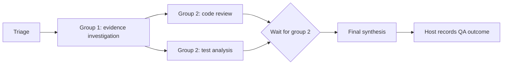
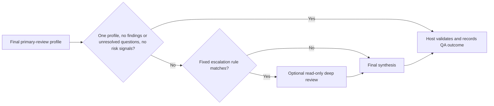

# QA Orchestrator Policy

The MCP transport, setup wizard, and responsibility boundary are client-neutral.
The **primary host** — Codex or Claude Code —
remains the main orchestrator and decision owner. The selected model IDs are
configuration metadata; the host still owns model execution and validation.

## Responsibility boundary

The primary host owns:

- task classification and retrieval of authoritative sources;
- converting the evidence state into a small set of content-free deep-review signals;
- requirements, diff, code, contract, log, and runtime analysis;
- launching model stages under the fixed policy and validating their responses;
- findings, severity, coverage, release/readiness judgment, and the final response;
- CodeGraph and source-MCP calls;
- code/file changes and all writes to external systems.

QA Orchestrator owns only deterministic profile routing, bounded orchestration state, and deep-review signal evaluation. The orchestrator does not accept evidence, prompts, or model outputs and does not perform autonomous writes. It validates the sequence the host reports; it cannot confirm the host performed each review or that host-reported risk signals reflect evidence.

FastMCP sends concise advisory instructions during initialization. The canonical full host rules remain in `client-rules/generic/QA_ORCHESTRATOR_INSTRUCTIONS.md`; initialization metadata does not enforce host behavior.

## Model policy

A missing model-policy file selects `host_default`. The session returns only
`{"mode":"host_default"}`; the host uses its own configured model and reasoning
for each stage. `qa-orch setup` is optional and writes an explicit `configured`
policy with a provider, four model IDs, and provider-specific reasoning/effort.
Use `qa-orch setup --host-default` to return to host mode. Legacy policy files
without `mode` continue to mean `configured`.

In `configured` mode, the OpenAI provider runs through Codex and uses
`model_reasoning_effort`; Anthropic uses `output_config.effort`. The OpenAI
catalog describes Codex with ChatGPT sign-in: it offers `low`, `medium`, `high`,
`xhigh`, `max`, and `ultra` for non-Luna models, while Luna supports up to
`max`. These subscription options differ from the OpenAI API's
`reasoning.effort`; API-key sessions can have different capabilities. For
Anthropic, `none` is a local sentinel meaning omit effort and use model defaults.
`high` remains the recommendation for deep escalation when supported.
The orchestrator never calls models or stores API keys. Model IDs and reasoning
are configured independently for each stage and returned in `model_policy`.

| Stage | Selected model | Reasoning / effort | Responsibility |
|---|---|---|---|
| Triage | configured `triage_model` | configured `triage_reasoning` (default `max`) | Select a fixed review bundle or compatibility profile and identify evidence gaps |
| Primary review | configured `primary_model` | configured `primary_reasoning` (default `medium`) | Run the declared execution groups; parallelize independent profiles when the host supports it |
| Deep escalation | configured `deep_model` | configured `deep_reasoning` (default `high`) | Optional read-only check for a complex or high-risk case |
| Synthesis | configured `synthesis_model` | configured `synthesis_reasoning` (default `medium`) | Consolidate the result after host validation |

In `configured` mode, the session returns the current stage's provider, model, reasoning policy, and transition constraints. In `host_default`, it returns no provider, model, or reasoning values; the host uses its own configuration. `reasoning_capabilities_verified` is true only when the exact model ID has an explicit local catalog entry for that provider; false means the host must verify the selected effort with its provider. This flag does not check account access or live provider capabilities. Execution speed and latency preferences are controlled by the host user's settings; the orchestrator does not set or override them. The primary host runs the models in its own environment, validates findings, and makes the final decision. The model-policy response is configuration metadata, not proof of model execution.

### Keeping the recommended model catalog current

The Codex catalog source and last-review date live beside `MODEL_CATALOGS` in `src/qa_orchestrator/model_policy.py`. Tests fail when that review is more than 180 days old. Before refreshing it, verify model IDs and subscription effort support against the [official Codex model guide](https://learn.chatgpt.com/docs/models), then update the catalog and its exact reasoning-option assertions in `tests/test_model_policy.py`. Keep custom model IDs available and do not add provider calls to setup; the host remains responsible for verifying model access.

## Orchestration flow

1. For `ordinary_review` and `widget_review`, the host first resolves the exact task/MR revisions and diff, prepares the compact Evidence Packet and schema-v2 input manifest, and passes them as `review_context` to `start_qa_orchestration`. A task/MR URL alone is insufficient. Non-review task types may omit `review_context`. The call returns a `run_id`, the active model-policy mode, and the next action. `host_default` uses the host's configured model and reasoning; `configured` returns explicit per-stage settings.
2. After triage, the host calls `advance_qa_orchestration` with one fixed bundle or one of the ten `ReviewAgent` profiles. Use one profile for a narrow, single-concern, low-risk review; a higher file count alone does not require a bundle. When `implementation_review=true` and triage selects one eligible implementation reviewer, the returned route appends one sequential `omission_auditor` pass. `code_explorer`, `pr_test_analyzer`, and `omission_auditor` are not eligible for this automatic addition. Bundles already include the auditor; explicitly test-only/evidence-only (`false`) and legacy requests (omitted intent) keep their selected route.
3. Use `selected_review_routes` from the successful triage response; it includes the selected checklist(s) and `execution_groups`, whose flattened order matches the returned routes. The stateless preparation tools remain available for standalone lookup or recovery. Run each group as a barrier: profiles in the same group may be reviewed concurrently when the host supports parallel workers; otherwise use the sequential fallback. Wait for all profiles in a group, then report the full group once through `completed_profiles`, in fixed route order. Older hosts may keep using `completed_profile` one at a time. Never submit transition calls concurrently. Retry a failed role or run it in the parent before reporting the group; if it remains incomplete, end with an honest `partial` or `blocked` outcome. The orchestrator validates the sequence the host reports, but cannot confirm a review actually ran or ran concurrently.
4. In the same transition that reports the final primary-review group, the host supplies evidence-based `risk_signals` (use an empty object when none apply). Any true signal includes a rationale and supporting Evidence Packet refs; a bound session checks that those refs are registered. The orchestrator applies fixed deep-review rules to the host-reported signals but cannot verify that they reflect evidence. The host advances according to the deep-review assessment. A route containing exactly one profile may set `skip_synthesis=true` when that profile reports no findings, no unresolved material questions, and every risk signal is false. An implementation-aware selection of one eligible reviewer has two profiles after triage, so it always runs the omission audit and normal synthesis. Bundles and any non-clean review continue through normal synthesis.
5. After deep review, the host uses the returned synthesis policy or its own configured model in `host_default` mode.
6. After synthesis or the eligible clean single-profile fast path, the state becomes `awaiting_host_outcome`; the host completes its final QA validation and calls `finish_qa_orchestration` with the same `run_id` and a status of `completed`, `partial`, or `blocked`. The orchestrator moves the session to its final status. For an early stop, first pass `partial` or `blocked` to `advance_qa_orchestration`, then finish the session with that same status.

`recommended_bundles` starts with a task-type shortlist: ordinary reviews recommend `ordinary_mr`; widget reviews recommend `widget` and `widget_js`; epic, requirements, and QA-planning tasks recommend `requirements`; autotest implementation recommends `autotest` and `ordinary_mr`; `other` has no base shortlist. Changed web TSX files add `widget`; web JSX files add `widget_js`. Mobile-only React paths suppress those web bundles and add `mobile`; a mixed MR keeps hints for both stacks. Python, Ruby, and other recognized mobile paths add the matching stack bundle. These suggestions never restrict `allowed_bundles` or select a route; the host confirms the stack from source and manifests before choosing. Plain `.js` remains ambiguous and gets no React hint from its extension alone.

Allowed transitions:

```text
Triage → execution group 1 → ... → execution group N
         [profiles in a group may run concurrently]
         [record each complete group once in route order]
                         ↘ clean single-profile fast path → awaiting host outcome
                                      ↘ Deep review ↗
                         Final synthesis → awaiting host outcome
```

Transition identifiers are model-neutral, not model selectors: use the returned `model_policy` for each stage.

Sessions are in memory by default, with a default TTL of `1800` seconds and a default limit of `100` active sessions. Successful transitions and finalization refresh the TTL; reads do not. Set `QA_ORCHESTRATOR_SESSION_STORE_PATH` to opt into a local SQLite file that restores unfinished structured state and finalized sessions with review artifacts after a restart. It contains no raw evidence, prompts, source, logs, model responses, or conversation history. For bound reviews it stores identifiers, submitted structured reports, and any bounded prior-review summaries explicitly supplied in the review context, including the final outcome. Finalized legacy sessions without review artifacts are removed from the store. Use one server process per file. The shared cache is bounded, so older terminal sessions may be evicted when new sessions are created. Unknown runs, expired sessions, illegal or repeated transitions, and invalid signals are rejected without changing state. Without the optional store, the host starts a new session after a restart.

Normal execution schedule for `ordinary_mr`:

```text
Triage → Faraday — Evidence Investigator
       → wait for its evidence map
       → Code Reviewer ─┐
       → Test Analyzer ─┴→ both may run concurrently
       → wait for both; record both with one `completed_profiles` call
       → Final synthesis
       → Host final QA outcome
```

The triage response and stateless bundle tool return these explicit waves as
`execution_groups`; they are
schedule metadata for the host, not model launches performed by the server.
Workers receive the shared compact Evidence Packet, relevant deduplicated
outputs from earlier groups (such as the evidence map), their own checklist,
and the primary-review model/reasoning from `model_policy`. They do not make
source-MCP or CodeGraph calls, writes, or final decisions; they return missing
evidence needs to the parent. The primary host owns evidence retrieval, state
transitions, candidate validation, synthesis, and the final decision. Parallel
requests may increase concurrent token use even when elapsed time falls. The
host's model and reasoning settings remain unchanged.

Bundles always use synthesis. The clean single-profile fast path is available only when the selected route contains one profile and the host confirms no findings, no unresolved material questions, and no risk signals; an implementation-aware selection of one eligible reviewer adds `omission_auditor` and therefore uses synthesis. The host still produces the complete final QA result.

Deep read-only review appears only after the last primary-review profile and when the fixed signal rules match; the flow then continues to final synthesis.

### Adaptive profile selection

The single-profile compatibility path is for narrow reviews. The triage stage should select one profile instead of a full bundle when the review has one narrow concern, one repository, low risk, and a small related changed surface. File count alone does not define scope:

| Scope | Selection |
|---|---|
| Changed behavior, callers, or failure path | `code_reviewer` |
| Test-only or assertion-only change | `pr_test_analyzer` |
| TypeScript, async, or serialization-only change | `typescript_reviewer` |
| React state, effects, or rendering-only change | `react_reviewer` |
| Ruby behavior or Ruby-specific runtime contract | `ruby_reviewer` |
| Python async, serialization, or MCP tool contract | `python_reviewer` |
| React Native or native iOS/Android behavior | `mobile_reviewer` |

Use a fixed bundle when the scope is broad, crosses concerns, or needs evidence mapping plus implementation and test review. The orchestrator does not infer this from raw source; the host supplies evidence for triage and submits only the selected fixed profile or bundle.

Select profiles from the changed paths and confirmed manifests, not the repository name alone: monorepos can mix Ruby, legacy JavaScript, TypeScript, React Native, native mobile, and infrastructure files. When one diff spans multiple stacks, choose the fixed bundle matching its broadest or highest-risk changed surface; keep uncovered stack-specific checks in the host's verification plan. Do not submit a custom profile list.

The `autotest` bundle includes `typescript_reviewer`; use it for broad TypeScript automation changes. For broad non-TypeScript automation, use `ordinary_mr`; for a narrow test-only change, use `pr_test_analyzer`. The `widget` bundle is for broad TypeScript React changes; use `widget_js` for broad JavaScript React changes, and `react_reviewer` for a narrow React-only change. Web TSX/JSX file hints add the corresponding bundle to the shortlist, while mobile-only React Native paths recommend `mobile`; mixed MRs can suggest both stacks. A plain `.js` extension does not prove React; confirm it from imports or the package manifest. Use `ruby_backend` for broad Ruby backend changes and `ruby_reviewer` for a narrow Ruby-specific review. Use `python_backend` for broad Python/MCP changes and `python_reviewer` for a narrow Python/MCP review. Use `mobile` for broad React Native/native mobile changes and `mobile_reviewer` for a narrow platform-specific change. Apply Rails checks only when Rails is confirmed, and job checks only when the repository uses a background-job library. See the [offline evaluation cases](PROFILE_EVALUATION.md) for the selection checks.

### Compact review context

The host inspects the full diff once and keeps one per-task Evidence Packet with changed behavior, source locators, and verified facts. Give each profile only relevant sections; reopen source only to confirm a concrete candidate or resolve a named link. Evidence items use stable local references such as `E1`, and finding candidates use stable identifiers such as `F-01`. `code_explorer` returns an evidence map and unresolved links, not defect candidates. `code_reviewer` uses that map and reports only concrete candidates supported by the changed code and evidence. Test analysis reports coverage gaps; specialist profiles stay within their returned focus. A finding candidate includes evidence references, confidence, and a verification gap; when supported by the Evidence Packet, it also includes `source_locations`, `affected_area`, and concrete `impact`. Profiles do not assign severity. Profiles do not repeat the full diff or raw logs, and synthesis receives deduplicated candidates and references rather than full transcripts. Routes return only the sections relevant to their profile: evidence map, finding candidates, coverage gaps, and unverified items are separate outputs.

An optional `review_context.prior_review_decisions` carries bounded dispositions
from an earlier review of the same merge request. When present,
`current_merge_request_source_id` must explicitly select the current
`merge_request` source from the input manifest, and every prior item must name
that same source. Each item also names the reviewed head, a candidate ID,
the prior disposition, a short summary, and a `prior_review` evidence ref whose
locator is under that MR and whose revision matches the reviewed head. For an
older head, the host must verify it is an ancestor of the current head and set
`revision_relation="verified_ancestor"`; otherwise the history is rejected.
The prompt labels these items as historical data and requires checking them
against current source. A previous status is not proof that a current finding
exists or is resolved. History is supplied per session, retained only with that
session's normal TTL when persistence is enabled, and is not automatically
learned or shared across MRs.

Profile reports also carry `scenario_coverage`: concise material behavior scenarios with a disposition (`candidate`, `refuted`, `unverified`, or `not_applicable_to_diff`), bound evidence refs, and rationale. The `omission_auditor` runs after specialist profiles in bundles and receives a bounded queue of prior candidate or unverified scenarios, unverified notes, and coverage gaps. For `implementation_review=true`, one eligible implementation reviewer always gets a final auditor pass, including when its first report is clean. Other single-profile routes get one targeted auditor pass only when they leave an unresolved item. Risk assessment runs after the auditor. It checks the queue against the same bound evidence before its independent omission sweep. Queue truncation must be reported as a gap. This adds one host model pass and can increase token use and elapsed time; it does not establish a recall improvement without a paired, adjudicated benchmark.

### Bound and retained review artifacts

For `ordinary_review` and `widget_review`, a schema-v2 `review_context` is required before starting the session. It binds the run to a repository, distinct base and head commit IDs, the SHA-256 of the exact diff and compact Evidence Packet, changed paths, stable evidence-reference IDs, and the host-authored input inventory/conflict statuses. Hash the exact bytes used by the host; do not include credentials in the repository identifier. The server stores these identifiers and the submitted structured reports, not the raw diff or full Evidence Packet. Other task types may omit `review_context`.

New sessions expose `audit_events` and `audit_trace_complete`: a bounded, ordered trace for session start,
each accepted workflow transition, and finalization. Events record the server
timestamp, revision, from/to stage and status, selected route, completed
profiles, request ID where supplied, and a hash of the submitted transition or
final report. Each event hash includes the session `run_id` and prior event
hash; loading a session validates session binding, sequence, chain links, and
from/to state continuity. Raw transition payloads are not duplicated in the
trace. Lease renewals do not advance the workflow revision and are omitted.
This records what the host submitted; it does not prove that a model or review
worker actually ran. Sessions persisted by older versions may have no trace.

For every report-bound review, register each material acceptance criterion as a separate `requirement` evidence item and each material MR behavior claim as a separate `claim` item. The final report's `criterion_coverage` maps each registered item to expected behavior, outcome, implementation refs, test/CI refs, and rationale. The server preserves omitted items as `unverified` and validates that supplied refs are bound and match their evidence kinds. This matrix records the host's assessment; it does not certify model reasoning or an external test run.

The final report's `scenario_coverage` carries the disposition matrix through synthesis. Any unique material scenario present in profile reports but omitted from the final matrix is added as `unverified`; additional scenarios beyond matrix capacity remain visible in `coverage_gaps`. Scenario refs outside the bound Evidence Packet are rejected. Treat this as traceability and an omission guard, not proof that a model reasoned over each row.

For every completed primary-review profile, pass one `profile_reports` item in the same order as `completed_profile` or `completed_profiles`. A report records the profile, reviewed scope, finding candidates, coverage gaps, unverified items, and evidence map. Set `reviewed_changed_paths` to every changed path the profile actually inspected, including paths with no finding; this is an executor attestation, not proof of model reasoning. Each finding candidate must cite one or more IDs from `review_context.evidence_refs`; the server rejects unknown IDs and reports for the wrong profile. Optional `execution_metrics` may record host-observed start/completion timestamps and input/output token counts; each fresh adapter attempt is also bound to the review head/diff and can record prompt/packet hashes, included evidence refs, included source paths, and CLI stdin write completion. For completion, the orchestrator checks that these receipt fields match the profile selection and bound review. They remain host/executor-reported evidence: this consistency check does not prove provider acknowledgement or model reasoning. Final Markdown reports separate these values from the paths the executor attested as reviewed. `code_explorer` and `pr_test_analyzer` cannot submit implementation finding candidates.

Final reports may include `verification_records` for tests, CI, or runtime checks. Bind each record to the exact `head_sha`, name the scenario and environment, retain a source/run reference, and give a reason for failed, skipped, unrun, cancelled, or unknown results. Runtime evidence refs must be registered runtime items for that same head. The host supplies these records; they are not independently authenticated by the orchestrator. If none are supplied, the Markdown report states that verification records are absent.

For `outcome="completed"`, `finish_qa_orchestration` requires a `final_review_report` with the reviewed profiles, summary, synthesized candidates, coverage gaps, and unverified items. At finalization, the server replaces `coverage_ledger` with host-derived facts bound to the ordered changed-path list and, when available, the exact diff hunk inventory: which paths have registered head-source records, which have verified text excerpts, which excerpts were included in a packet with a matching executor receipt, and which paths/hunks the executor attested it inspected. The receipt must bind the head and diff, source and selected packet hashes, included and omitted refs, included source paths, prompt hash, and a host-observed completed CLI stdin write. The report renderer resolves the indexes to paths and calls out missing source records, unavailable or unverified source text, missing or mismatched executor receipts, and missing path/hunk inspection attestations. Completion is rejected unless every profile has a matching executor input receipt, at least one non-explorer reviewer received a verified text excerpt for every text path, non-explorer profiles attest inspection of every changed path, and every hunk in a complete bound inventory has a non-explorer reviewer attestation; unresolved coverage must finish as `partial`. A missing source excerpt, executor receipt, complete hunk inventory, or inspection attestation remains a visible coverage gap, not a claim that the path or hunk was checked. The receipt describes the recorded handoff; it does not prove provider acknowledgement or model reasoning, and even a recorded path/hunk attestation does not prove reasoning. Final candidates must include their source profiles, each contributing profile-local candidate ID, and registered evidence IDs. The server verifies that every source pair exists in the submitted profile reports and that final finding evidence refs and source locations are supported by those linked candidates; it also checks overall Evidence Packet membership. The host remains responsible for the truth of the report and final QA decision. A clean single-profile path may still skip the synthesis stage, but it supplies the final report at finish.

Each profile report is limited to 72 KiB and each final report to 80 KiB of serialized data; combined session review artifacts are limited to 288 KiB and at most ten profile reports are accepted. Keep the Evidence Packet and raw model responses outside these reports. These report-bound sessions and their structured reports are retained in the configured SQLite session store, if enabled, until the normal session TTL or capacity eviction. They are available through `get_qa_orchestration`; `list_qa_orchestrations` includes repository, head SHA, diff hash, and whether reports are present. Reports saved before source-candidate linkage was added remain recoverable with empty `source_candidates`; they can be replayed idempotently but cannot be used to finalize a new session. Without `review_context`, the legacy content-free workflow remains available and no structured reports are accepted.

### Host candidate decisions

New final reports account for every submitted profile candidate in `candidate_decisions`. Each decision retains its source profile/local ID, verdict (`confirmed`, `rejected`, `duplicate`, `unverified`), rationale and registered evidence refs. Every decision requires a context-bound refutation check: `not_refuted` for confirmed/duplicate, `refuted` for rejected, and `unverified` for unverified. Confirmed and duplicate decisions link an existing final finding. New profile submissions must state a concrete `failure_condition`, `flip_condition`, `expected_behavior`, and source-predicted `actual_behavior`; this prediction is not runtime proof. Rejected and unverified decisions retain the exact original candidate snapshot so Markdown reports can show its description and counterevidence even when no final finding is emitted. Every final finding needs a confirmed source and exact source linkage. The host supplies final severity, impact, affected area, behavior pair, failure/flip conditions, and source locations. A restored in-progress legacy session whose candidate predates those conditions can be finalized as unverified with its original snapshot; it cannot be confirmed without resubmitting a current profile review. Old saved reports can still be read and replayed idempotently.

### Deterministic deep-review decision

After the final primary-review profile, the host sends boolean signals plus one concise rationale and the Evidence Packet references that support every enabled signal. It must not send raw evidence:

```json
{
  "high_risk_domain": true,
  "evidence_uncertain": true,
  "cross_system_scope": false,
  "multiple_plausible_causes": false,
  "evidence_conflict": false,
  "non_reproducible": false,
  "high_blast_radius": false,
  "rationale": "The authorization contract and changed owner check remain unresolved.",
  "evidence_refs": ["E1", "E2"]
}
```

The orchestrator enters the optional deep-review branch when one of these rules matches:

1. `high_risk_domain` and `evidence_uncertain` are both true;
2. at least two complexity signals are true: `cross_system_scope`, `multiple_plausible_causes`, `non_reproducible`, or `high_blast_radius`;
3. `evidence_conflict` is true and the conflict is high-impact because `high_risk_domain`, `cross_system_scope`, or `high_blast_radius` is also true.

Map observed conditions to signals only when evidence supports them. Sensitive identity, security, payment, fraud, privacy, or access-control impact maps to `high_risk_domain`; a specific unresolved material conclusion that a scoped read-only review could plausibly resolve maps to `evidence_uncertain`; a relevant boundary crossing repositories, services, or systems maps to `cross_system_scope`; multiple plausible causes remaining after investigation map to `multiple_plausible_causes`; disagreement between relevant authoritative sources maps to `evidence_conflict`; an expected behavior that cannot be reproduced maps to `non_reproducible`; and broad impact across consumers or data maps to `high_blast_radius`. When any signal is true, `rationale` and at least one `evidence_refs` entry are required; bound sessions reject refs outside the supplied packet. These remain host-reported claims, not proof that the signal is true. Do not set `evidence_uncertain` solely because CI, Stage, or runtime checks were not run. Keep such gaps in the verification plan unless they leave a specific high-impact code or contract question the deep review can investigate. A profile's escalation text or an ordinary coverage gap alone does not set a signal. The host supplies the signals and the fixed rules above determine whether deep review runs.

When deep review is selected, carry the named unresolved question and its Evidence Packet references into the host's review context. Inspect only evidence needed to answer that question; do not repeat the full diff or primary profiles. If resolution requires unavailable runtime or external evidence, mark the question unverified and continue to synthesis.

The returned `deep_assessment` contains `should_escalate`, matched fixed rules, fixed reason codes, and the complexity-signal count. The session retains `risk_signals`, including the host rationale and Evidence Packet refs, but does not store raw evidence. `risk_signals` remains the only input for deep-review assessment.

## Visual workflow

### Normal MR review



### Deep review escalation



## Fixed bundles and profile names

| Bundle | Ordered profiles | Execution groups (each group is a barrier) |
|---|---|---|
| `ordinary_mr` | `code_explorer` → `code_reviewer` → `pr_test_analyzer` → `omission_auditor` | (`code_explorer`) → (`code_reviewer`, `pr_test_analyzer`) → (`omission_auditor`) |
| `widget` | `code_explorer` → `react_reviewer` → `typescript_reviewer` → `pr_test_analyzer` → `omission_auditor` | (`code_explorer`) → (`react_reviewer`, `typescript_reviewer`, `pr_test_analyzer`) → (`omission_auditor`) |
| `widget_js` | `code_explorer` → `code_reviewer` → `react_reviewer` → `pr_test_analyzer` → `omission_auditor` | (`code_explorer`) → (`code_reviewer`, `react_reviewer`, `pr_test_analyzer`) → (`omission_auditor`) |
| `ruby_backend` | `code_explorer` → `ruby_reviewer` → `pr_test_analyzer` → `omission_auditor` | (`code_explorer`) → (`ruby_reviewer`, `pr_test_analyzer`) → (`omission_auditor`) |
| `python_backend` | `code_explorer` → `python_reviewer` → `pr_test_analyzer` → `omission_auditor` | (`code_explorer`, `python_reviewer`, `pr_test_analyzer`) → (`omission_auditor`) |
| `mobile` | `code_explorer` → `mobile_reviewer` → `pr_test_analyzer` → `omission_auditor` | (`code_explorer`) → (`mobile_reviewer`, `pr_test_analyzer`) → (`omission_auditor`) |
| `security` | `code_explorer` → `security_reviewer` → `silent_failure_hunter` → `omission_auditor` | (`code_explorer`) → (`security_reviewer`, `silent_failure_hunter`) → (`omission_auditor`) |
| `autotest` | `code_reviewer` → `typescript_reviewer` → `pr_test_analyzer` → `omission_auditor` | (`code_reviewer`, `typescript_reviewer`, `pr_test_analyzer`) → (`omission_auditor`) |
| `requirements` | `code_explorer` → `code_reviewer` → `omission_auditor` | (`code_explorer`) → (`code_reviewer`) → (`omission_auditor`) |

| Technical profile | Display name |
|---|---|
| `code_explorer` | `Faraday — Evidence Investigator` |
| `code_reviewer` | `Code Reviewer` |
| `pr_test_analyzer` | `Test Analyzer` |
| `security_reviewer` | `Security Reviewer` |
| `silent_failure_hunter` | `Silent Failure Hunter` |
| `typescript_reviewer` | `TypeScript Reviewer` |
| `react_reviewer` | `React Reviewer` |
| `ruby_reviewer` | `Ruby Reviewer` |
| `python_reviewer` | `Python Reviewer` |
| `mobile_reviewer` | `Mobile Reviewer` |
| `omission_auditor` | `Omission Auditor` |

Faraday is the internal display name for `code_explorer`. It is not a separate external agent, service, package, or model. The orchestrator returns only the fixed identifier and order; the host runs the configured primary model for each role.

## Review profiles

Use the narrowest profile that matches the task:

- `pr_test_analyzer` — test intent, branch coverage, and missing regression protection;
- `code_reviewer` — changed surface, caller impact, contracts, and failure paths;
- `security_reviewer` — authentication, authorization, validation, secrets, and data exposure;
- `silent_failure_hunter` — swallowed errors, fallback paths, false success, and observability;
- `code_explorer` — dependency map, callers, data flow, and affected surface;
- `typescript_reviewer` — TypeScript types, async boundaries, serialization, and build safety;
- `react_reviewer` — React state, effects, rendering, props, and user-visible behavior.
- `ruby_reviewer` — Ruby semantics, ActiveRecord or Sequel behavior, and relevant Sidekiq retry/concurrency contracts when repository evidence confirms those libraries;
- `python_reviewer` — Python async/error behavior, data validation, serialization, and relevant FastMCP tool contracts when present;
- `mobile_reviewer` — React Native/native lifecycle, permissions, navigation, bridge, and platform-specific behavior on changed paths.
- `omission_auditor` — an independent final pass over changed paths and earlier reports for distinct, missed failure modes.

`code_explorer` owns evidence mapping; specialist profiles own their focused candidates; `omission_auditor` owns a final search for distinct omissions. It receives earlier profile reports and must not repeat their candidates. The role sequence is a host-execution claim, not proof that every possible defect was found.

Every review must separate confirmed findings from hypotheses and unverified runtime or release facts. An empty or unknown profile is rejected before a route is built.

## Retry-safe transitions and active leases

Sessions expose a workflow `revision`. Each accepted transition and first finalization increments it. Pass `expected_revision` to reject a new stale write; pass it with a unique `request_id` to make an advance retry safe. The server retains bounded request hashes and applied revisions with recovery state. The exact same keyed payload returns current state without repeating work or refreshing TTL, including after restart when the same store is configured. Changed payloads under an existing key fail. A replay can return later progress, so follow the returned current step/revision. Unkeyed callers keep the legacy behavior.

`renew_qa_orchestration(run_id, expected_revision)` refreshes an active session's lease without changing its workflow revision, reports, or request receipts. Renew before expiry while a host worker runs. Awaiting-host-outcome sessions are also active; terminal and expired sessions cannot be revived. The host adapter renews during work, uses versioned keyed submissions, and retries transport timeouts/lost connections with the same payload. A stale host cannot mark another host's progressed session partial.

## Final outcome

`finish_qa_orchestration` accepts `run_id`, the host-owned final outcome, and an optional `final_review_report`. A newly started context-bound session requires a complete required-input manifest and a closed impact ledger bound to the same head, changed-path digest, discovery digest, and exact discovery candidate set before it can be finalized as `completed`; any ledger evidence refs must belong to the bound packet. Input completeness policy v1 derives required source kinds from changed path categories: API/contract, database, event, job, config, authorization, deployment, and service-boundary changes require their relevant contract/schema plus consumer or dependency maps. The final report shows the derived categories and any missing source kinds. An unavailable map stays an incomplete required source; a local CodeGraph scan cannot prove there are no external consumers. Any unknown or partial input/impact status must finish as `partial` or `blocked`. Impact closure covers every candidate in the recorded bounded discovery result; it does not assert exhaustive repository coverage. If discovery hits its eligible-candidate result limit, the omitted count is bound into `ReviewContext` and a strict review cannot finish as `completed` until discovery is rerun without that omission. Sessions restored without the completion-mode field retain legacy behavior. In-memory sessions remain bounded by TTL and capacity; when local persistence is configured, sessions with structured review artifacts remain recoverable after restart until TTL expiry, capacity eviction, or explicit deletion. Legacy sessions without reports keep the previous behavior and are removed from the recovery store at finalization. Repeating the same outcome and report is idempotent; a conflicting outcome or report is rejected.

## Discard a session

`delete_qa_orchestration(run_id)` explicitly removes one session from memory and
configured recovery storage, regardless of lifecycle stage. This is distinct
from recording an early stop or final QA outcome: the deleted state is no longer
available for get, advance, finish, listing, or restart recovery. The tool does
not cancel host tasks or model executions and must not replace normal finalization.

Deletion is irreversible and idempotent. The response's `deleted=true` means the
ID is absent, including if already missing or expired. No other session is
purged or renewed. Under the session lock, the persisted row is removed before
memory; a storage failure leaves memory intact and permits a later retry. Use
only when the host intentionally discards that particular session.

## MCP tools

The orchestrator must publish exactly:

- `prepare_qa_orchestration`;
- `prepare_qa_orchestration_bundle`;
- `get_qa_orchestration_model_policy`;
- `get_qa_orchestration_catalog`;
- `start_qa_orchestration`;
- `advance_qa_orchestration`;
- `get_qa_orchestration`;
- `list_qa_orchestrations`;
- `finish_qa_orchestration`;
- `delete_qa_orchestration`.
- `renew_qa_orchestration`.

`read_only=true` and `host_owns_decisions=true` must be preserved in every orchestration state. Do not add a tool that generates text, accepts evidence, changes external state, selects a model for the host, or silently calls another agent.

`get_qa_orchestration_model_policy` takes no arguments and returns the tagged
selection loaded by the current server for new sessions: `host_default` has no
provider/model/reasoning fields; `configured` returns explicit per-stage values.
It creates no session, rereads no disk, and contacts no provider. After changing
a policy, restart the server connection before checking it. This is configuration
metadata, not host execution telemetry. For an existing recovered session,
follow its returned `model_policy`; a later transition uses the restarted
server's policy.

`list_qa_orchestrations` takes no arguments and returns brief metadata
for non-expired sessions retained by this server, including retained terminal
sessions. It reads a locked in-memory snapshot without renewing TTL, deleting
expired rows, or writing storage. Entries are sorted by expiry descending, with
`run_id` as tie-breaker. Use it to recover a lost ID, then call
`get_qa_orchestration(run_id)` for full state; confirm the intended session when
multiple entries match. Expired and evicted sessions are excluded. After restart,
unfinished sessions and finalized sessions with review artifacts restored from
configured storage are available.

`get_qa_orchestration_catalog` takes no arguments and returns the fixed profiles
with their names and focus, bundles with usage guidance and ordered profile IDs,
and task-type recommendation shortlists. It requires no session and does not
create one, change state or TTL, write storage, or contact providers. Catalog
definitions come from the same fixed profile and bundle definitions used by
preparation and triage. Choose a route from the changed files and confirmed
stack; task-based recommendations do not restrict the choices. The successful
`advance_qa_orchestration` triage response includes `selected_review_routes`
with the selected checklist(s) and ordered groups. Use
`prepare_qa_orchestration(agent_profile)` or
`prepare_qa_orchestration_bundle(bundle)` for standalone lookup or recovery.

## Persistence and safety

The service does not store task content, conversation history, a source cache, or persistent QA memory. Before adding a field, verify that it can be aggregated without exposing its source and that the primary host still makes the final decision.
